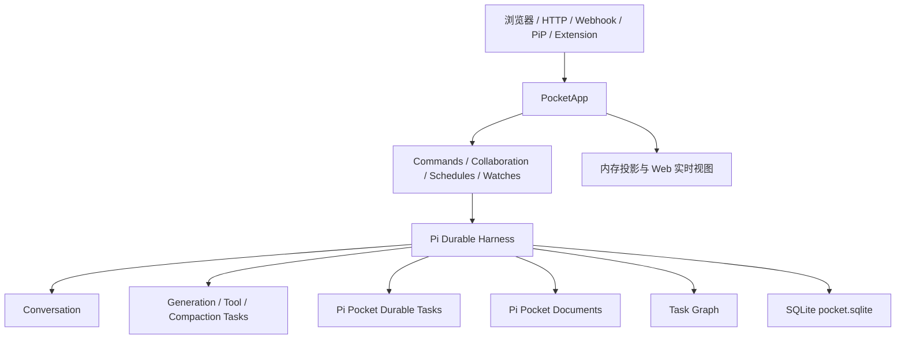

# Pi Pocket 在 Pi Durable 之上的实现

本文从源码角度说明 Pi Pocket 如何使用 Pi Durable 实现持久化会话、模型执行、工具调用、后台任务、定时消息、PiP、GitHub Watch、多人协作和重启恢复。

当前代码版本：

- Pi Pocket：`0.25.0`
- Pi Durable：`1.4.0`
- 主要实现入口：`src/server/app.ts`
- Durable 文档定义：`src/server/docs.ts`
- 数据库：`~/.pi-pocket/pocket.sqlite`，或 `PI_POCKET_DIR` 指定的数据目录

---

## 1. 一句话概括

Pi Pocket 不是自己实现一套聊天记录和任务恢复系统，而是把 Pi Durable 作为底层的：

- Conversation 引擎；
- Entry 历史存储；
- Generation、Tool、Compaction 执行引擎；
- Durable Task 调度器；
- Document Store；
- 事务和提交系统；
- SQLite 持久化层；
- 重启恢复机制。

Pi Pocket 在此之上实现产品层能力：

- 用户、角色和权限；
- 多人协作；
- 模型和 provider 管理；
- spend 限制；
- session 列表；
- PiP；
- 定时消息；
- PR 和 repository watch；
- webhook；
- 后台进程；
- 扩展系统；
- HTTP API 和移动端 Web UI。

核心关系如下：



可以把职责边界理解为：

> Pi Durable 保证工作和状态可以持久化、事务化、检查点化并恢复；Pi Pocket 决定谁可以做什么，以及这些工作如何呈现在产品中。

---

## 2. 分层架构

```text
第一层：Pi Durable
    conversation、entry、task、checkpoint、memo、transaction、SQLite

第二层：Pi Pocket 的 Durable domain
    schedules、watches、PiP、background、memory、sessions、spend、authors

第三层：PocketApp orchestration
    权限、模型、request attribution、恢复、commit coordinator、room projection

第四层：产品表面
    HTTP、多人协作、浏览器、手机 UI、推送、扩展和主题
```

一次普通消息的完整路径是：

```text
浏览器 POST /api/c/:id/submit
    ↓
Commands.submit()
    ↓
Conversation.submit()
    ↓
Pi Durable generation task
    ↓
Pi Durable tool task
    ↓
逐步 commit 到 pocket.sqlite
    ↓
PocketApp 的 commit coordinator
    ↓
Room / Web event
    ↓
web/store.js
    ↓
Preact 渲染
```

源码主要位于：

- `src/server/app.ts`：`PocketApp`、Harness、启动、恢复、commit coordinator；
- `src/server/commands.ts`：用户如何发送消息、创建 session、fork、resend、compact；
- `src/server/docs.ts`：Pi Pocket 自己定义的 Durable documents；
- `src/server/running.ts`：从 Durable task graph 生成“当前正在运行什么”的视图；
- `src/server/schedules.ts`：定时消息 task；
- `src/server/watches.ts`：PR watch task；
- `src/server/repo-watches.ts`：repository watch task；
- `src/server/pip.ts`：PiP follow task；
- `src/server/background.ts`：后台进程 task；
- `src/server/extension-commands.ts`：扩展命令 task；
- `src/server/reload.ts`：扩展加载和 Durable registry 集成。

---

## 3. Pi Durable 提供的核心对象

### 3.1 Harness

`Harness` 是 Pi Pocket 和 Pi Durable 之间的总入口。

`src/server/app.ts` 中的初始化大致如下：

```ts
const storage = await openNodeSqliteStorage(join(this.dataDir, "pocket.sqlite"));

this.harness = await Harness.open(
    storage,
    {
        models: this.models,
        registry,
        settings: this.#harnessSettings(),
        now: this.now,
        env: ({ conversationId, cwd }) => this.#wrapped(conversationId, cwd ?? this.defaultCwd),
        conversationCreated: async (tx, conversation) => {
            await tx.doc(AuthorsDoc, conversation.id);
            await tx.doc(ArtifactsDoc, conversation.id);
            await tx.doc(SubagentsDoc, conversation.id);
        },
    },
    context,
);
```

Harness 连接了：

```text
SQLite storage
+ model runtime
+ task registry
+ runtime settings
+ command environment
+ conversation lifecycle
```

Pi Pocket 的所有 session、subagent 和浏览器连接共享同一个 Harness，但只有一个 server 进程可以打开同一个数据目录。

---

### 3.2 Conversation

每一个 Pi Pocket session 都对应一个 Durable conversation。

Conversation 持有或关联：

- 用户消息；
- assistant 回复；
- thinking；
- tool call；
- tool result；
- agent 配置；
- 当前 live 状态；
- compaction 状态；
- submission records；
- fork 关系；
- generation、tool 和子任务。

Pi Pocket 获取 conversation 的入口是：

```ts
const conversation = await this.harness.conversation(id, context);
```

发送消息最终调用：

```ts
conversation.submit(
    {
        type: "input",
        content,
        whenBusy: "followUp",
        requestId,
    },
    context,
);
```

---

### 3.3 Entries

Conversation 中的每个重要步骤都会被保存成 Durable entry，例如：

- 用户输入；
- assistant message；
- thinking；
- tool call；
- tool result；
- Pi Pocket 的内部消息；
- shell 或扩展产生的消息。

这些内容不是在整轮执行结束后一次性保存，而是在 generation 和 tool task 执行过程中持续提交。因此即使 server 在中途重启，也能从最后一个已经提交的阶段继续。

---

### 3.4 Task Graph

Pi Durable 将所有正在执行的工作建模为 task graph。

Pi Pocket 通过以下方式读取任务图：

```ts
const graph = await app.harness.taskGraph(context);
```

`src/server/running.ts` 会把 Durable task 转换成用户可以理解的描述：

| Durable task               | Pi Pocket 显示的含义 |
| -------------------------- | -------------------- |
| `pi.generation`            | 正在写回答           |
| `pi.tool`                  | 正在运行工具         |
| `pi.compaction`            | 正在压缩上下文       |
| `pocket.schedule`          | 定时消息             |
| `pocket.pr-watch`          | 观察 Pull Request    |
| `pocket.repo-watch`        | 观察 Repository      |
| `pocket.pip-follow`        | PiP 正在跟踪 session |
| `pocket.background`        | 正在运行后台命令     |
| `pocket.shell`             | 正在执行 shell 命令  |
| `pocket.extension-command` | 正在运行扩展命令     |

任务图是“当前工作是什么”的统一来源，而不是各个模块分别维护自己的运行列表。

---

### 3.5 Documents

Pi Durable 提供 document store，Pi Pocket 在 `src/server/docs.ts` 中定义自己的业务 documents。

典型定义如下：

```ts
export const ScheduleDoc = defineDoc<{ items: Record<string, Schedule> }>({
    kind: "pocket.schedules",
    version: 1,
    ...rebased,
    scope: "conversation",
    history: "latest",
    fork: "initial",
    initial: () => ({ items: {} }),
});
```

这些 documents 和 conversation entries 存在同一个 `pocket.sqlite` 中，可以在同一个 Durable transaction 内更新。

---

## 4. 持久化边界

### 4.1 Pi Durable 持久化的数据

位于：

```text
~/.pi-pocket/pocket.sqlite
```

主要包括：

- conversations；
- entries；
- submission records；
- Durable tasks；
- task checkpoints；
- task memos；
- agent 状态；
- live 状态；
- Pi Pocket 的 documents。

这些是 server 重启后需要恢复的持久事实。

---

### 4.2 Pi Pocket 自己维护的外部文件

以下状态不在 Durable SQLite 中：

```text
config.json
push.json
provider-limits.json
uploads/
worktrees/
extensions/
themes/
```

其职责分别是：

- `config.json`：用户、角色、token、配置；
- `push.json`：Web Push 订阅和密钥；
- `provider-limits.json`：provider 限流状态的提示性缓存；
- `uploads/`：上传文件；
- `worktrees/`：Git worktree；
- `extensions/`：用户安装的 drop-in extensions；
- `themes/`：用户主题。

其中 `provider-limits.json` 不是最终事实。即使文件损坏或丢失，Durable generation 状态仍然有效，只是下一次请求可能需要重新探测 provider 限制。

---

### 4.3 进程内临时状态

重启后会丢失的状态包括：

- 当前连接的浏览器；
- typing 状态；
- tab 的投影缓存；
- 当前审批对象；
- provider sign-in 进行中的临时状态；
- 部分 session list 缓存；
- 当前连接对应的 Room 和 Client 对象。

这些都不是最终事实。启动时会从 Durable storage 重新构建必要的内存状态。

---

## 5. PocketApp 启动和恢复流程

`PocketApp.#open()` 的顺序很重要，大致如下：

### 第一步：获取数据目录锁

通过 `harness.lock` 保证同一数据目录只有一个 Pi Pocket server 进程使用。

这不限制多人访问；多人可以连接同一个 server。它限制的是两个 server 进程同时打开同一个数据库。

---

### 第二步：加载 settings 和 models

Pi Pocket 初始化：

- Pi settings；
- HTTP proxy；
- provider retry settings；
- model runtime；
- model stream timing；
- limit gate；
- model list。

---

### 第三步：创建 Durable registry

```ts
const registry = createRegistry();
registry.install(CodingTools);
```

然后安装 Pi Pocket 自己的 Durable 扩展：

```ts
registry.install(
    defineExtension({
        name: "pocket-core",
        tasks: [
            ResendTask,
            this.commands.interruptTask,
            this.shell.task,
            this.commands.followTask,
            this.extensionCommands.task,
        ],
        hooks: [
            hook(ToolTask, {
                afterTool: (_call, result, api) => {
                    const cleaned = this.hidden.result(result, api.conversationId);

                    return cleaned === result ? undefined : cleaned;
                },
            }),
        ],
    }),
);
```

扩展模块也会通过 registry 安装自己的 tools、tasks 和 hooks。

---

### 第四步：打开 SQLite 和 Harness

Pi Pocket 用 `openNodeSqliteStorage()` 打开 `pocket.sqlite`，再由 `Harness.open()` 加载 Durable 状态。

`conversationCreated` 会为每个 conversation 提前创建 Pi Pocket 的核心 documents：

- `AuthorsDoc`；
- `ArtifactsDoc`；
- `SubagentsDoc`。

这样 Room 和其他模块从 conversation 创建之初就可以读取这些文档。

---

### 第五步：恢复 PocketApp 内存状态

`#recover()` 遍历所有 conversation，并读取：

```ts
LiveDoc;
AgentDoc;
ChatDoc;
AuthorsDoc;
SubagentsDoc;
BackgroundDoc;
```

它恢复：

- 哪些 session 正在运行；
- 当前 agent 和 model；
- 当前 chat；
- 当前 subagent；
- Pi 当前为谁工作；
- 后台任务；
- 进行中的 compaction。

如果 crash 发生在“消息已经进入 Durable，但作者文档尚未更新”的窗口内，Pi Pocket 会从 Durable submission 和 entry 记录中补齐作者信息，并通过一个 commit 修复 `AuthorsDoc`。

---

### 第六步：订阅 commits

```ts
this.#unsubscribeCommits = this.harness.subscribeCommits((publication) =>
    this.#committed(publication),
);
```

所有后续 Durable commit 都会进入 PocketApp 的统一 commit coordinator。

---

### 第七步：恢复未完成的工作

```ts
this.harness.resume();
```

这一步会恢复上一个 server 进程留下的：

- generation；
- tool task；
- compaction；
- schedule；
- PR watch；
- repository watch；
- PiP follow；
- background watcher；
- extension command task。

恢复放在所有 commit listener 注册之后，确保恢复产生的第一个 commit 不会被遗漏。

---

## 6. 普通用户消息的完整执行过程

### 6.1 HTTP 层和权限检查

`Commands.submit()` 首先检查：

```ts
app.requireSee(user, id);
await app.requireDriver(id, user);
```

然后检查：

- PiP 是否可用；
- session 是否有 model；
- spend limit；
- take-turns；
- plan mode；
- linked session admission；
- 附件和文件权限。

---

### 6.2 输入预处理

在交给 Durable 之前，Pi Pocket 会处理：

- `/skill:name`；
- prompt template；
- 隐藏值替换；
- 附件说明；
- `@` mention 文件；
- 图片内容；
- `[via ...]` 标记；
- 外部输入的 fencing 和 defanging。

这些是 Pi Pocket 的产品逻辑，不是 Pi Durable 的职责。

---

### 6.3 request id 和幂等性

浏览器为每次提交生成 request id。Pi Pocket 将其转换为：

```text
u:<userId>:<clientKey>
```

或者代表某个用户发送时：

```text
p:<userId>:<clientKey>
```

含义是：

- `u:`：用户自己的消息；
- `p:`：代表用户发送的消息，例如 schedule、PiP、webhook、linked session。

提交前，Pi Pocket 会通过：

```ts
tx.submissionByRequest(id, requestId);
```

判断同一个 request 是否已经进入 Durable。这样浏览器遇到网络超时后重试，不会造成重复消息。

---

### 6.4 Generation 和 Tool task

Durable 接管后，大致执行：

```text
generation
  → 请求模型
  → 保存 thinking / assistant content
  → 发现 tool call
  → 创建 tool task
  → 保存 tool result
  → 继续 generation
  → 提交最终 assistant message
```

每个重要阶段都会提交到 SQLite，因此 server 在中途退出后，Durable 可以从最后一个安全 checkpoint 恢复。

---

## 7. Pi Pocket Durable Document 设计

### 7.1 `kind`

例如：

```text
pocket.sessions
pocket.authors
pocket.schedules
pocket.background
pocket.memory
```

`kind` 是存储数据的一部分，不能随意重命名，否则已有 session 可能无法读取旧文档。

---

### 7.2 `scope`

`scope` 表示文档属于哪个范围：

- `session`：session/app 级状态；
- `conversation`：一个 conversation 的状态；
- app-wide document：不绑定某个 conversation。

---

### 7.3 `history`

很多 Pi Pocket 文档使用：

```text
history: "latest"
```

表示应用只需要当前值，而不需要逐步读取完整历史。

---

### 7.4 `fork`

`fork` 决定 conversation fork 时文档如何处理：

- `initial`：fork 后从初始值开始；
- `current`：继承当前值；
- 也有些文档由 `Commands` 在 fork 初始化函数中显式复制或裁剪。

例如：

- schedule 属于原 session，fork 后不应继承；
- Authors 只保留 fork 之前的消息作者；
- linked session peers 在 fork 后清空；
- plan 和 notes 在特定 fork 场景下显式复制。

---

### 7.5 Document rebase

`src/server/docs.ts` 中定义了统一的 rebase 条件：

```ts
const rebased = {
    checkpointWhen: (_value, _ops, info) => info.deltasSinceBase >= 64,
};
```

Durable document 使用 base + delta 存储。频繁更新的文档如果只积累 delta，冷启动时需要回放大量操作，因此 Pi Pocket 会在累计一定数量的 delta 后重新写入 base。

这是存储优化，不改变文档语义。

---

## 8. 自定义 Durable Task 的共同模式

Pi Pocket 的 schedule、watch、PiP follow 等任务，都使用类似的定义方式：

```ts
this.task = defineTask<Input, State, Outcome>({
    name: "pocket.some-task",
    version: 1,
    initial: () => ({ phase: "wait" }),
    phases: {
        wait: ...,
        work: ...,
    },
    abort: ...,
});
```

一个自定义 Durable task 通常包括：

1. 稳定的 task name；
2. task version；
3. 初始 checkpoint；
4. 多个 phase；
5. 每个 phase 的持久状态；
6. abort handler；
7. terminal outcome。

---

### 8.1 Task 和业务 document 同事务创建

创建 schedule 时，task 和 document 记录在一个事务中创建：

```ts
return app.harness.commit(async (tx) => {
    const doc = await tx.doc(ScheduleDoc, conversationId);

    const taskId = await tx.createTask(
        this.task,
        { scheduleId: id },
        {
            ownership: { kind: "conversation" },
            background: true,
            conversationId,
        },
    );

    doc.items[id] = {
        ...schedule,
        taskId,
    };

    return schedule;
}, context);
```

这样不会出现：

- schedule document 已写入，但 task 创建失败；
- task 已存在，但没有对应的业务记录。

---

### 8.2 `sleepUntil()` 是持久化等待

schedule 的等待 phase：

```ts
return runtime.sleepUntil(schedule.next, { phase: "send" }, context);
```

这不是普通的 `setTimeout()`，而是持久化 checkpoint。任务会保存为类似：

```text
status: sleeping
until: <timestamp>
checkpoint: { phase: "send" }
```

因此：

- server 重启不会丢失等待；
- deadline 已经过期时，任务会立即继续；
- 任务等待期间不需要一直持有一个运行中的 invocation。

---

### 8.3 先保存 checkpoint，再执行副作用

PR watch 和 repository watch 会先查询 GitHub，再把准备发送给 Pi 的消息保存到 checkpoint：

```ts
return {
    status: "running",
    checkpoint: {
        phase: "send",
        text,
        seen,
    },
};
```

之后 send phase 才真正调用 `Commands.submit()`。

这样即使 server 在查询完成、消息发送之前退出，恢复后仍然知道应该发送什么内容。

---

### 8.4 稳定 request id 防止重复副作用

schedule、watch、repository watch 和 PiP 都会为发送消息生成稳定 request id。

恢复时，即使 send phase 被再次执行，Durable 仍然可以用：

```ts
tx.submissionByRequest(...)
```

识别同一条消息是否已经提交过。

Pi Pocket 的核心假设不是“phase 只会运行一次”，而是：

> phase 可能重放，因此所有副作用都必须通过 request id、memo、checkpoint 或已有状态变得幂等。

---

## 9. 主要自定义 Durable Task

### 9.1 Schedule

文件：

```text
src/server/schedules.ts
```

执行流程：

```text
wait
  → sleepUntil(next)
  → send
  → 删除一次性 schedule
  → 或更新 runs / next
  → 回到 wait
```

重复 schedule 会保存下一次执行时间。PiP 关闭时，PiP 的 schedule 不会直接执行，而是继续等待，直到 PiP 恢复。

`ScheduleDoc` 保存：

- schedule id；
- 文本；
- 发送内容；
- 下次执行时间；
- 时区；
- repeat 信息；
- requester；
- 已执行次数；
- 对应 task id；
- 幂等 key。

---

### 9.2 PR Watch

文件：

```text
src/server/watches.ts
```

执行流程：

```text
wait
  → sleepUntil(next)
  → look
  → 查询 GitHub
  → 保存 checkpoint
  → send
  → 更新已通知的 comment/check/commit
  → 回到 wait
```

watch 会持久化：

- 已通知的评论；
- 已通知的失败 commit；
- conflict 状态；
- 检查失败次数；
- 下次检查时间；
- 当前 watch 状态。

---

### 9.3 Repository Watch

文件：

```text
src/server/repo-watches.ts
```

观察内容包括：

- issues；
- pull requests；
- workflow runs；
- releases；
- comments。

它与 PR watch 使用相同的 Durable 模式：

```text
wait → look → checkpoint → send → wait
```

---

### 9.4 PiP Follow

文件：

```text
src/server/pip.ts
```

PiP follow task 会：

1. 等待目标 session 的运行结束；
2. 读取最终回复或失败结果；
3. 生成报告文本；
4. 把报告发送回 PiP；
5. 在 `FollowsDoc` 中记录完成状态。

如果 PiP 临时关闭，报告发送会通过 `sleepUntil()` 延迟，而不是丢失。

---

### 9.5 Extension Command

文件：

```text
src/server/extension-commands.ts
```

每次扩展命令运行都是一个 Durable task。

它使用 task memo 保存：

- 是否已经开始执行；
- handler 的最终结果。

如果 server 重启时 task 已经开始但没有 result，恢复后不会再次执行可能具有副作用的 handler，而是报告该次执行被中断。

---

### 9.6 Background Command

文件：

```text
src/server/background.ts
```

后台命令不能只依赖 Durable，因为真正的命令进程运行在操作系统中。因此 Pi Pocket 使用：

```text
Durable task
+
OS process marker / pid / process group / exit file
```

启动过程：

1. 在 Durable transaction 中预留任务；
2. 写入 `starting` 状态；
3. 启动外部进程；
4. 将 pid、startTicks、boot 信息写回 document；
5. watcher task 观察进程组；
6. 进程结束后读取 exit code 和日志；
7. 更新 `BackgroundDoc`；
8. 必要时向 Pi 发送结果消息。

如果 server 在进程已启动但 pid 尚未写回时崩溃，恢复逻辑会根据 marker 查找并接管遗留进程；如果找不到，则根据 exit file 判断命令是否曾经运行。

---

### 9.7 Shell Command

`!` 和 `!!` 命令也使用 Durable task 和 request document。

目标是：

- 重试同一个请求不会执行两次；
- server 重启不会重复执行同一 shell command；
- 输出可以保存到 transcript；
- server 退出时，正在运行的 shell 能被标记为中断。

---

## 10. Commit Coordinator

Pi Durable 会发布 commit，但不同 change 的顺序不能被 Pi Pocket 当作业务顺序依赖。因此 `PocketApp` 使用统一的：

```ts
#committed(publication: CommitPublication)
```

处理所有变更。

### 第一阶段：先处理 usage

```ts
this.spend.usageChanged(change.conversationId, change.value as UsageState | null);
```

同一个 commit 里可能同时发生：

```text
模型 usage 增加
+
新的用户消息改变 requester
```

usage 必须归属于模型调用开始前的 requester，因此 usage 必须先处理。

---

### 第二阶段：处理各类 change

Document change 进入：

```ts
this.#documentCommitted(change);
```

它会更新：

- `#busy`；
- `#agents`；
- session list；
- background 状态；
- room；
- subagent board；
- memory；
- schedules；
- browser view。

Submission change 进入：

```ts
this.attribution.submissionCommitted(change.value);
```

它会更新：

- 谁提交了消息；
- 谁是 requester；
- provider 是否恢复；
- run 是否失败；
- session list 的失败状态。

这也是为什么 Pi Pocket 不让多个模块各自定义一套 commit listener：否则 billing 和 attribution 的顺序会变成隐含规则。

---

## 11. 内存状态与 Durable 状态同步

`PocketApp` 内部有很多内存集合：

```ts
#busy;
#failed;
#agents;
#parents;
#subagents;
#sessions;
#endedAt;
```

这些只是 Durable 状态的投影，不是独立真相。

启动时：

```text
SQLite / Durable snapshot
    → #recover()
    → PocketApp 内存状态
```

运行时：

```text
Durable commit
    → #committed()
    → 更新内存状态
```

浏览器只看到已经 commit 的状态，不会看到只存在于某个尚未提交的内存变量中的 speculative state。

---

## 12. Web 实时视图

服务器端 `Room` 将 Durable conversation 和 Pi Pocket documents 投影成浏览器事件：

```text
Durable commit
    ↓
PocketApp.#committed()
    ↓
Room.schedule()
    ↓
view / chat / peek / subagents event
    ↓
web/store.js
    ↓
Preact render
```

浏览器收到的是适合网络传输的 projection，而不是 SQLite 原始数据。projection 包括：

- entries；
- live run；
- tool 状态；
- session metadata；
- side chat；
- approvals；
- subagent board；
- provider limit 状态。

更新会被节流和合并：

- room 更新最多约每 90ms；
- session list 约每 400ms；
- peek tile 约每秒一次。

Durable 负责正确性，Room 和 projection 负责性能与前端传输格式。

---

## 13. Fork 如何与 Durable 集成

Pi Pocket 使用 Durable conversation fork：

```ts
conversation.fork(...)
```

同时还需要在 fork 初始化时处理自己的 documents：

- 写入 `SessionsDoc`；
- 记录 `forkedFrom`；
- 复制或重置 `ChatDoc`；
- 处理 Pins；
- 截断 Authors；
- 按文档语义决定哪些配置继承；
- 创建新的 worktree；
- resend fork 创建新的 Durable task。

因此 fork 实际上是：

```text
Durable conversation fork
+
Pi Pocket document fork policy
+
新的 session metadata
+
新的 task / worktree
```

PiP conversation 不能普通 fork，因为 PiP 有特殊的 owner、extension 选择和上下文压缩规则。

---

## 14. 多人协作、request attribution 和 spend

Pi Pocket 不通过“最近访问网页的人”判断 Pi 为谁工作，而是通过 request id 和 Durable submission 记录判断。

例如：

```text
u:alice:key
p:alice:key
```

Pi Pocket 根据这些信息判断：

- 谁写了消息；
- Pi 当前为谁工作；
- spend 归谁；
- 谁应该处理 approval；
- schedule、webhook、PiP 的消息归谁；
- subagent 继承谁的 requester；
- linked session 使用哪个人的权限。

`AuthorsDoc` 是快速查询的业务投影。恢复时，如果它缺少数据，Pi Pocket 会从 Durable submission 和 entry 记录重新推导。

`SpendDoc` 中的 `counted` 字段用于保证每笔 usage 只计费一次，即使发生重启或重复读取。

---

## 15. PiP 为什么必须使用 Durable

PiP 不是一个单纯的前端 panel，而是一个特殊的 conversation。

它有：

- 自己的 conversation；
- 自己的 agent 配置；
- 自己的 extension 选择；
- 自己的 Durable tasks；
- 自己的 compaction；
- 自己的 follow 记录；
- 自己的 report 发送流程。

相关 documents 包括：

```text
pocket.pip-follows
pocket.pip-asked
pocket.pip-compaction
```

如果这些状态只放在内存中，server 一重启就会丢失 PiP 正在跟踪的 session、等待中的报告和已完成的 follow。因此 PiP 的 follow、report 和等待状态都使用 Durable task 保存。

---

## 16. 模型调用和 provider 限流

Pi Pocket 在 Durable generation 之外增加了 `LimitGate`：

```text
src/server/limit-gate.ts
```

调用层次大致是：

```text
timing wrapper
    ↓
limit gate
    ↓
models.streamSimple
    ↓
provider
```

如果 provider 返回可等待的限流错误，例如：

- 429；
- 5xx overload；
- provider usage window；
- 某些带 reset time 的 provider 限制；

Pi Pocket 会在同一个 model stream 内等待并重试，使 Pi Durable 看到的是一个持续时间更长的请求，而不是立即失败的 generation。

限流 gate 本身不是 Durable truth：

- 重启后 Durable generation 从 request phase 恢复；
- 再次进入 limit gate；
- `provider-limits.json` 只用于避免无谓的第一次失败请求；
- 真正的 generation 状态仍由 Durable 保存。

Pi Pocket 设置：

```ts
restartLimit: Infinity;
```

因为一个 Durable phase 可能等待数小时，不能因为 server 发生多次非正常重启，就让该任务被 crash-loop guard 永久停住。

---

## 17. Extensions 如何接入 Durable

Pi Pocket 的扩展来自两个目录：

```text
src/server/extensions/
~/.pi-pocket/extensions/
```

扩展可以注册：

- tools；
- prompt sections；
- hooks；
- commands；
- browser modules；
- HTTP routes；
- Durable tasks；
- documents；
- services。

扩展通过 `PocketHost` 访问 Pi Pocket，而不是直接访问 `PocketApp`。

扩展可以动态 reload：

- 已经运行的 tool 使用旧版本；
- 下一次调用使用新版本；
- 关闭扩展会移除其 tools、routes、commands 和 browser module；
- 已经创建的 Durable task 必须依据自身设计安全结束或继续运行。

---

## 18. Tool execution 和隐藏值保护

Pi Pocket 在 `ToolTask` 上注册了 `afterTool` hook：

```ts
afterTool: (_call, result, api) => {
    const cleaned = this.hidden.result(result, api.conversationId);

    return cleaned === result ? undefined : cleaned;
};
```

作用是：

- 扩展隐藏值不进入 tool result；
- secret 不进入 Durable entry；
- secret 不进入 transcript；
- secret 不通过浏览器 projection 泄露。

同时，Harness 的 `env` 回调会为每个 conversation 提供包装后的命令环境：

```ts
env: ({ conversationId, cwd }) => this.#wrapped(conversationId, cwd ?? this.defaultCwd);
```

该环境被 shell、bash、codemode、checks 和 background command 共用。

---

## 19. 重启和崩溃恢复

Pi Pocket 的恢复模型不是“保存整个进程内存快照”，而是：

```text
持久化 task / document / entry
    ↓
新进程启动
    ↓
打开同一个 Harness
    ↓
恢复 PocketApp 内存投影
    ↓
Harness.resume()
    ↓
继续未完成的工作
```

### 正常关闭

`PocketApp.close()` 最终调用：

```ts
await this.harness.close(context);
```

Pi Pocket 特别保持一个语义：

> close 不把正在执行的工作写成最终失败；下一个进程打开数据库后继续恢复。

### 不同副作用的恢复策略

| 副作用          | 恢复策略                                 |
| --------------- | ---------------------------------------- |
| 模型 generation | Durable generation phase                 |
| tool call       | Durable tool task                        |
| compaction      | Durable compaction task                  |
| 定时消息        | `sleepUntil()` + 稳定 request id         |
| GitHub watch    | 先写 checkpoint，再发送消息              |
| 扩展命令        | `started` / `result` memo                |
| 后台进程        | Durable task + OS process marker         |
| shell 命令      | request document + Durable task          |
| PiP follow      | task phase + report checkpoint           |
| spend           | usage document + `counted` 字段          |
| 作者归属        | AuthorsDoc + Durable submission recovery |

---

## 20. 事务、一致性和幂等性原则

### 原则一：Durable 状态是事实，内存只是缓存

```text
SQLite / Durable document
    > PocketApp memory
    > browser store
```

浏览器和进程内存都可以重建，SQLite 中的 Durable 状态才是长期事实。

---

### 原则二：任务和业务状态尽量同事务提交

例如：

```text
创建 schedule
+
创建 Durable task
+
写入 ScheduleDoc
```

应该在同一个 commit 中完成。

---

### 原则三：任何可重放代码都必须幂等

不能假设一个 phase 只执行一次。常用机制包括：

- stable request id；
- `submissionByRequest()`；
- task memo；
- checkpoint；
- document 中的 `counted`；
- reserve-before-side-effect；
- OS process marker；
- 外部系统自身的幂等接口。

---

### 原则四：外部副作用前先保存意图

例如 watch：

```text
先把准备发送的消息写入 checkpoint
再发送消息
```

这样恢复后不会丢失“应该发送什么”。

---

### 原则五：不可安全重放的动作要保存 started/result

扩展命令等可能有外部副作用的操作，应记录：

```text
started memo
+
result memo
```

如果 handler 已经启动但 result 尚未保存，恢复后不能盲目再次执行 handler。

---

### 原则六：commit 顺序是业务规则

Pi Pocket 明确规定：

```text
usage
    ↓
document changes
    ↓
submission attribution
    ↓
room / session / browser projection
```

不能让不同模块各自订阅并自行决定顺序。

---

## 21. 数据库升级和运行注意事项

Pi Durable `1.4.0` 会在打开 SQLite 时迁移数据库 schema。项目文档特别说明：

- Durable 1.4.0 使用 schema version 2；
- 旧版 Durable 可能无法打开已经迁移的数据库；
- 升级 Pi Pocket 前应停止 server；
- 应备份完整的 `~/.pi-pocket` 数据目录；
- 不能只备份 `pocket.sqlite`，因为 config、extensions、uploads 和 worktrees 也可能需要保留；
- 只有一个 server 进程可以使用同一个数据目录。

Pi Durable 目前仍是 experimental API，因此 `package.json` 对相关包版本做了固定。

---

## 22. 总结

Pi Pocket 在 Pi Durable 上的实现，可以归纳为：

```text
用户、扩展、定时器或外部事件产生请求
    ↓
Commands.submit() 或自定义 Durable task
    ↓
Durable transaction 写入 submission / task / document
    ↓
generation / tool / background task 持续推进
    ↓
每个阶段 commit 到 pocket.sqlite
    ↓
PocketApp commit coordinator 更新内存投影
    ↓
Room 向浏览器发送 committed view
    ↓
server 重启时 Harness.resume()
```

因此，Pi Pocket 的 durable 并不只是“把聊天记录写进 SQLite”，而是把以下工作都转换成可以事务化、检查点化、幂等化并恢复的系统：

- 模型调用；
- 工具调用；
- 上下文压缩；
- subagent；
- shell 和后台命令；
- 定时消息；
- PR 和 repository watch；
- PiP follow 和报告；
- 扩展命令；
- spend 和 requester attribution；
- 多人协作状态。

最终可以用一句话概括：

> Pi Durable 负责“工作不会凭空消失”，Pi Pocket 负责“工作由谁发起、谁有权执行、谁承担成本，以及用户如何看到它”。
